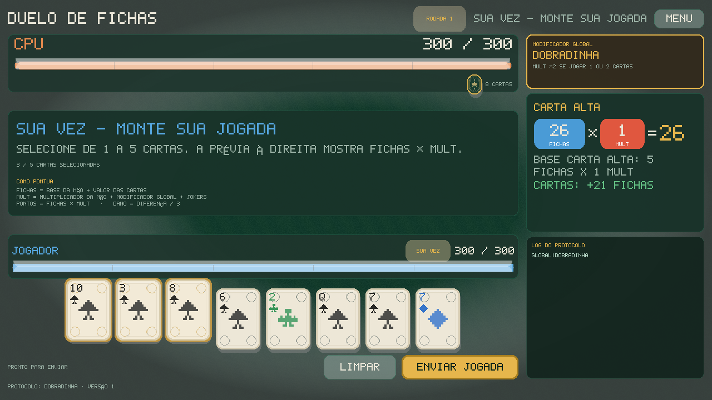
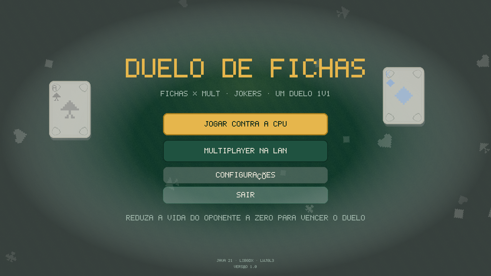
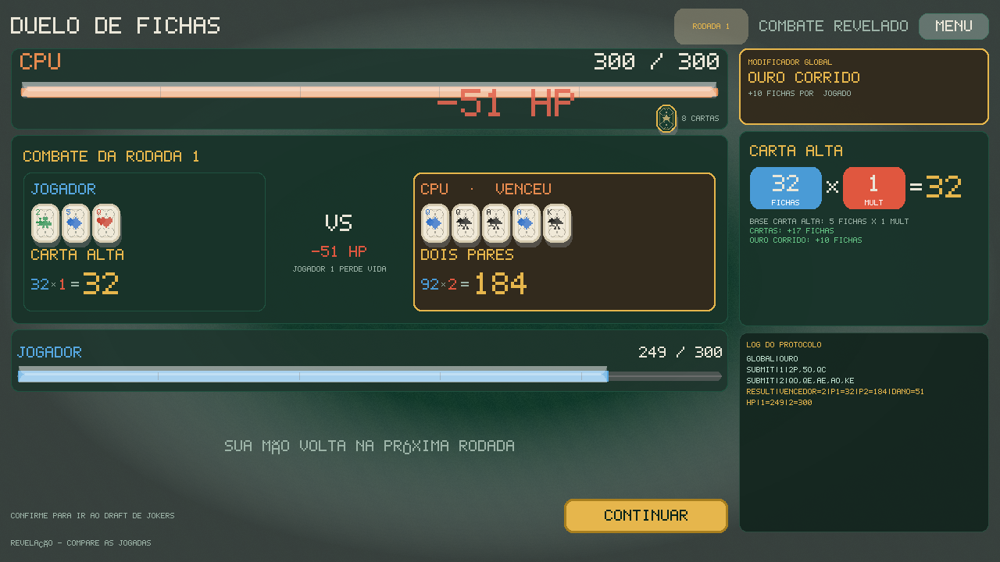
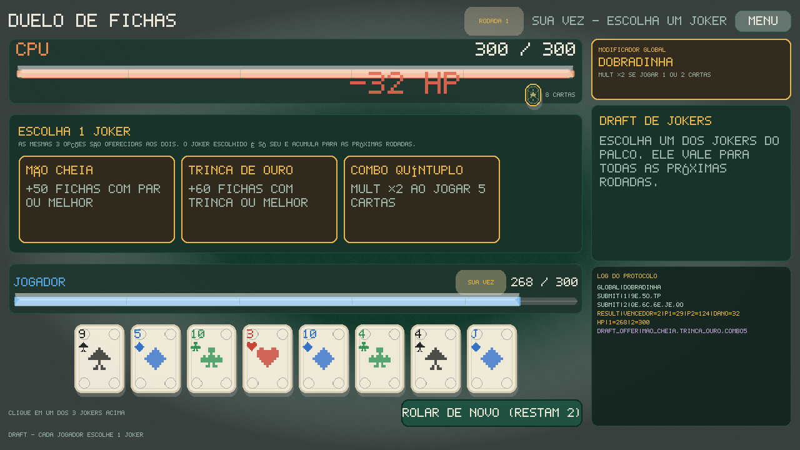

# Duelo de Fichas

Um duelo de cartas 1v1 inspirado no Balatro, feito como jogo desktop nativo em Java 21
com libGDX, LWJGL3, Netty e Jackson. 

---

## Executáveis autônomos (jogar sem instalar nada)

A pasta `dist/` contém duas compilações em arquivo único que embutem o Java 21, o jogo e
o servidor, portanto o jogador não precisa de Java nem de Gradle e pode executá-las
offline:

| Arquivo | Plataforma | Primeira execução |
|---|---|---|
| `DueloDeFichas.exe` | Windows 10/11 x64 | Descompacta em `%LOCALAPPDATA%\DueloDeFichas` e cria um atalho no Menu Iniciar |
| `DueloDeFichas-linux.run` | Linux x86-64 | Descompacta em `~/.local/share/duelo-de-fichas` e registra uma entrada na área de trabalho |

```bat
DueloDeFichas.exe
```

```bash
chmod +x DueloDeFichas-linux.run
./DueloDeFichas-linux.run
```

Os dois aceitam `--server --port=7777` para iniciar o servidor dedicado de LAN e
`--install-only` para instalar sem abrir o jogo.

Para gerá-los novamente depois de alterar o jogo:

```bash
python tools/packaging/build_packages.py
```

O executável do Windows precisa ser gerado no Windows. Consulte
[`tools/packaging/README.md`](tools/packaging/README.md).

---

## Como executar o jogo

### 1. Instale o Java 21

O jogo exige **JDK 21** (não basta um JRE). Você **não** precisa instalar o Gradle: o
wrapper incluído no projeto o baixa automaticamente. Verifique a versão do seu Java:

```bash
java -version
```

Se `java -version` não mostrar 21, instale o Temurin 21 ou outro JDK 21 e aponte a
variável `JAVA_HOME` para ele. Ajuste os caminhos abaixo para a versão instalada na sua
máquina.

**Windows (PowerShell):**

```powershell
$env:JAVA_HOME = "C:\Program Files\Eclipse Adoptium\jdk-21.0.13+9"
$env:Path = "$env:JAVA_HOME\bin;$env:Path"
java -version
```

**macOS / Linux:**

```bash
export JAVA_HOME=/caminho/para/jdk-21
export PATH="$JAVA_HOME/bin:$PATH"
java -version
```

### 2. Inicie o cliente do jogo

Abra um terminal na pasta do projeto (a pasta que contém `gradlew` e este README).

**Windows:**

```bat
gradlew.bat run
```

ou clique duas vezes em **`run-client.bat`**.

**macOS / Linux:**

```bash
./gradlew run
```

ou execute **`./run-client.sh`**.

A primeira execução baixa as dependências do Maven Central e leva um ou dois minutos; as
seguintes são imediatas. O jogo abre em uma janela de 1280×720.

### 3. Jogue

- **Um jogador:** clique em **JOGAR CONTRA A CPU**.
- **Multiplayer em LAN:** siga as instruções passo a passo da
  [seção 3](#3-multiplayer-em-lan).
- **Sair:** feche a janela ou use **SAIR** no menu principal.

### 4. Executar sem o Gradle (jars empacotados)

Gere os jars autônomos uma vez:

```bash
./gradlew clientJar serverJar
```

Depois execute-os diretamente (é assim que o jogo é iniciado depois da compilação):

```bash
java -jar build/libs/duelo-de-fichas-1.0.0.jar
java -jar build/libs/duelo-server-1.0.0.jar --port=7777
```

Jars gerados:

- `build/libs/duelo-de-fichas-1.0.0.jar` — cliente desktop
- `build/libs/duelo-server-1.0.0.jar` — servidor dedicado

No Windows os mesmos comandos funcionam no `cmd`/PowerShell depois de definir
`JAVA_HOME`.

### 5. Outros comandos úteis

```bash
./gradlew runServer   # servidor multiplayer dedicado (sem interface gráfica)
./gradlew test        # executa a suíte de 47 testes
./gradlew dist        # gera os dois jars autônomos
```

No Windows use `gradlew.bat` em vez de `./gradlew`.

### Solução de problemas

- **`JAVA_HOME is not set` / o Gradle não encontra o Java 21** — instale o JDK 21 e
  exporte `JAVA_HOME` como mostrado acima. O wrapper do Gradle precisa de um JDK, não de
  um JRE.
- **`gradlew` não é reconhecido (Windows)** — execute `gradlew.bat` na pasta do projeto
  ou use `run-client.bat`.
- **A porta 7777 já está em uso (ao criar a sala)** — a tela de anfitrião tenta
  automaticamente as portas seguintes; você também pode digitar outra porta. Para o
  servidor dedicado use `--port=7780` (ou qualquer porta livre).
- **Dois jogadores não conseguem se conectar pela LAN** — use o IP de LAN do anfitrião
  (mostrado na sala de espera), confirme que as duas máquinas estão na mesma rede e
  libere a porta no Firewall do Windows.
- **Nenhuma janela aparece** — confirme que a máquina oferece suporte a OpenGL 2.0+ e que
  o cliente não está sendo executado por uma sessão de área de trabalho remota sem
  aceleração de GPU.

---



### Menu principal



### Revelação do combate



### Escolha de curingas



---

## 1. Jogabilidade (portada da especificação HTML)

Cada partida começa com os dois jogadores com **300 de vida** e um **modificador global**
aleatório compartilhado por ambos. A cada rodada os dois jogadores recebem **8 cartas** de
um baralho novo de 52 cartas e cada um envia **de 1 a 5 cartas**. A jogada mais forte vence
a rodada; o perdedor sofre dano.

```
pontuação = round(fichas x mult)
dano = ceil((pontuaçãoVencedor - pontuaçãoPerdedor) / 3)
```

Empates não causam dano. O jogador que chegar a 0 de vida perde. Depois de cada rodada não
fatal, os dois jogadores recebem **os mesmos três curingas** e cada um escolhe um; os
curingas se acumulam pelo resto da partida. Cada jogador tem **2 rerolls por partida**.

### Valores das mãos

| Mão | Fichas | Mult |
|---|---:|---:|
| Carta Alta | 5 | 1 |
| Par | 10 | 2 |
| Dois Pares | 20 | 2 |
| Trinca | 30 | 3 |
| Sequência | 30 | 4 |
| Flush | 35 | 4 |
| Full House | 40 | 4 |
| Quadra | 60 | 7 |
| Straight Flush | 100 | 8 |

As cartas jogadas somam fichas: ás = 11, T/J/Q/K = 10, as demais valem a face. A sequência
A-2-3-4-5 conta como sequência.

### Modificadores globais (um por partida, vale para os dois)

| Modificador | Efeito |
|---|---|
| Mesa Rica | +20 fichas em toda jogada |
| Pressão Alta | +1 mult em toda jogada |
| Festa dos Naipes | +6 fichas por carta jogada |
| Dobradinha | mult x2 ao jogar 1 ou 2 cartas |
| Ouro Corrido | +10 fichas por ouros jogado |

### Curingas (3 oferecidos por rodada, uma escolha por jogador)

| Curinga | Efeito |
|---|---|
| Naipe Afiado | +15 fichas por espadas jogado |
| Combo Quíntuplo | mult x2 ao jogar 5 cartas |
| Mão Cheia | +50 fichas com par ou melhor |
| Rio de Fichas | +30 fichas em um flush |
| Par Perfeito | +4 mult com par ou melhor |
| Coração Valente | +12 fichas por copas jogado |
| Trinca de Ouro | +60 fichas com trinca ou melhor |
| Escada Firme | +50 fichas em uma sequência |
| Alto Risco | +40 fichas ao jogar exatamente 1 carta |

### Fluxo da rodada

1. Os dois jogadores recebem 8 cartas.
2. O jogador 1 monta e envia uma jogada.
3. O jogador 2 monta e envia uma jogada (as cartas do adversário permanecem ocultas).
4. O combate é revelado: pontuações, vencedor, dano e vida.
5. Os dois jogadores confirmam o resultado.
6. Escolha: os mesmos 3 curingas são oferecidos; cada jogador escolhe um (há rerolls).
7. Uma nova rodada começa com mãos novas. A partida termina quando um jogador chega a 0 de
   vida.

---

## 2. Um jogador

`Jogar contra a CPU` inicia uma partida local contra uma IA que usa **o mesmo
`ScoringEngine` e as mesmas regras de validação dos jogadores humanos**. Ela enumera toda
seleção legal (todas as combinações de 1 a 5 cartas), pontua cada uma e escolhe a melhor.
Também avalia as ofertas de curingas pelo valor marginal para a mão atual e usa rerolls
quando as ofertas são fracas.

---

## 3. Multiplayer em LAN

O servidor é autoritativo: valida cada ação, calcula todas as pontuações e danos e mantém
o estado canônico. Os clientes apenas renderizam instantâneos filtrados e enviam
intenções.

### Opção A — hospedar pelo cliente do jogo (servidor embutido)

1. Um jogador abre **Multiplayer → Criar sala** e confirma a porta TCP (padrão 7777).
2. A tela mostra um **código de sessão de 6 caracteres**, o IP de LAN do anfitrião e a
   porta.
3. Os dois jogadores abrem o cliente:
   - O anfitrião permanece na sala de espera.
   - O outro jogador escolhe **Entrar em sala**, informa o IP do anfitrião, a porta e o
     código.
4. A partida começa automaticamente quando os dois jogadores estão conectados.

Para jogar na mesma máquina, execute dois clientes e entre em `127.0.0.1` com o código
mostrado.

### Opção B — servidor dedicado

```bash
java -jar build/libs/duelo-server-1.0.0.jar --port=7777 --bind=0.0.0.0
```

O servidor imprime seus endereços de LAN na inicialização. Os jogadores então usam
**Entrar em sala** com esse IP/porta e o código mostrado pelo cliente anfitrião. Uma
máquina pode executar o servidor enquanto outras duas se conectam pela LAN.

### Configuração do servidor

`config/server.properties` (ou os valores padrão embutidos):

```properties
bindAddress=0.0.0.0
port=7777
maxSessions=32
maxPlayersPerSession=2
sessionTimeoutSeconds=120
connectionTimeoutSeconds=60
```

Substituições pela linha de comando: `--config=<arquivo>`, `--bind=<ip>`, `--port=<porta>`.

### Protocolo

TCP via Netty com quadros JSON em UTF-8 prefixados pelo comprimento de 4 bytes. Todo
envelope contém `type`, `messageId`, `sessionId`, `playerId`, `timestamp` e um payload
JSON.

Tipos de mensagem: `CREATE_SESSION`, `SESSION_CREATED`, `JOIN_SESSION`, `JOIN_ACCEPTED`,
`PLAYER_CONNECTED`, `PLAYER_DISCONNECTED`, `GAME_START`, `PLAYER_ACTION`,
`GAME_STATE_UPDATE`, `TURN_CHANGED`, `ROUND_RESULT`, `PLAYER_DAMAGE`, `GAME_OVER`,
`REMATCH_REQUEST`, `PING`, `PONG`, `ERROR`.

- `messageId`s duplicados são ignorados em vez de aplicados duas vezes.
- Jogadas fora do turno, cartas que não estão na mão, índices de oferta inválidos e
  sessões cheias são rejeitados com códigos de erro específicos.
- As atualizações de estado são filtradas por espectador: um cliente nunca recebe a mão do
  adversário.
- Um jogador desconectado pode retomar seu lugar com o token de reconexão da sessão
  (reconexão automática do cliente por 60 segundos).
- As sessões expiram após o tempo limite configurado se um lugar ficar vazio.

---

## 4. Controles

- **Mouse** — selecionar cartas, pressionar botões, escolher curingas
- **Esc** — voltar ao menu (fim de jogo: menu; menus: tela anterior)

---

## 5. Arquitetura

```
src/main/java/com/game/
├── core/
│   ├── model/     Card, Rank, Suit, Deck, HandType, HandEvaluator
│   ├── scoring/   ScoringEngine, curingas, modificadores globais, detalhamento da pontuação
│   ├── rules/     GameRules, CombatResolver, RoundOutcome
│   └── state/     GameEngine (autoritativo), GameSnapshot, PlayerView
├── ai/            BotBrain (mesma pontuação, sem matemática de IA separada)
├── net/protocol/  Tipos de mensagem, envelopes, payloads, codec Jackson
├── server/        ServerConfig, GameSession, SessionManager, GameServer Netty
├── client/
│   ├── network/   GameClient Netty + fluxo de ClientEvent enfileirado
│   ├── controller/MatchSession, LocalMatchSession, NetworkMatchSession
│   └── screens/   Menu principal, multiplayer, jogo, fim de jogo, configurações
├── rendering/     CardActor, CardHand, HealthBar, painéis, interface procedural
├── assets/        Arte procedural, atlas de texturas, fonte em pixels, skin Scene2D
└── launcher/      DesktopLauncher, ServerLauncher, DuelGame
```

O núcleo do motor não depende de libGDX nem de Netty e é coberto por testes unitários.
A camada de renderização consome apenas instantâneos imutáveis. A rede roda em threads do
Netty e publica eventos seguros para a interface, que as telas consomem na thread de
renderização.

### Recursos visuais

Todas as imagens são originais e geradas em código (`ProceduralArt`, `GameAssets`): feltro,
painéis, cartas, botões, ícones de naipes, brilhos e o atlas de texturas. A fonte bitmap em
pixels é gerada por `tools/FontGen.java` em `src/main/resources/assets/fonts/`:

```bash
javac -d /tmp/fontgen tools/FontGen.java && java -cp /tmp/fontgen FontGen
# ou: java tools/FontGen.java
```

### Modo de captura de tela para desenvolvedores

Para verificação visual, o inicializador pode renderizar uma tela, salvar um PNG e sair:

```bash
./gradlew run --args="--screenshot=C:/tmp/game.png --screen=game"
```

Telas válidas: `menu`, `multiplayer`, `settings`, `game`, `reveal`, `draft`, `gameover`.

---

## 6. Testes

```bash
./gradlew test
```

A suíte contém atualmente 47 testes. A cobertura inclui:

- categorias de mão, a sequência A-5, valores das fichas e arredondamento do multiplicador
- todos os curingas e modificadores globais, incluindo a ordem de empilhamento
- cálculo de dano e tratamento de empates
- ordem dos turnos, erros de validação, informação oculta, limites de escolha e rerolls
- uma partida completa CPU contra CPU até o fim de jogo e a revanche
- seleção de jogadas pela IA e avaliação de curingas
- uma sessão de um jogador com semente fixa, com a CPU escolhendo curingas até o fim de jogo
- ida e volta do protocolo JSON
- rejeição de comandos duplicados na sessão, tokens de reconexão, ações inválidas
- uma partida TCP ponta a ponta com dois clientes (criar/entrar, jogar, revelar, escolher,
  rodada 2, reconectar)
