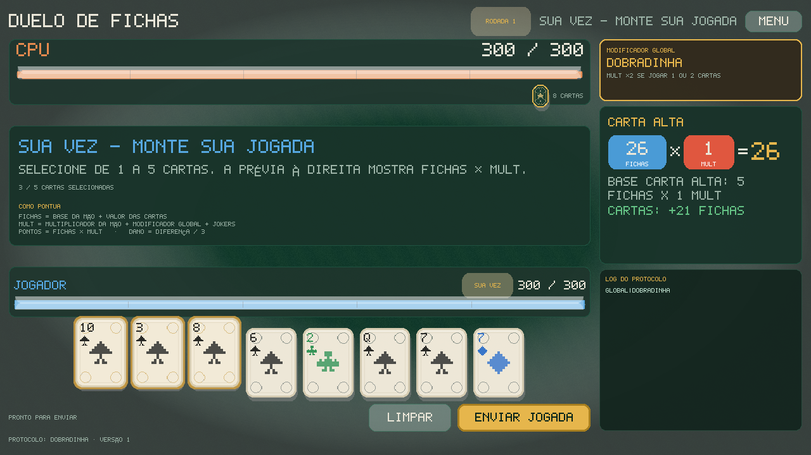

# Duelo de Fichas

Um duelo de cartas 1v1 inspirado no Balatro, feito como jogo desktop nativo em Java 21
com libGDX, LWJGL3, Netty e Jackson. As regras evoluíram do protótipo `Duelo de Fichas.html`
até a v0.13, com mão de 5 entre 8 cartas, uma mão de 7 poderes misturados por rodada, contagem
animada estilo Balatro e um modificador global compartilhado.
O jogo inclui uma mesa polida, IA para um jogador, multiplayer em LAN e um servidor
autoritativo autônomo. O modo de um jogador não precisa de navegador, servidor nem conexão
com a internet.

---

## Executáveis autônomos (jogar sem instalar nada)

A pasta `dist/` contém duas compilações em arquivo único que embutem o Java 21, o jogo e
o servidor, portanto o jogador não precisa de Java nem de Gradle e pode executá-las
offline:

| Arquivo | Plataforma | Primeira execução |
|---|---|---|
| `DueloDeFichas.exe` | Windows 10/11 x64 | Descompacta em `%LOCALAPPDATA%\DueloDeFichas` e cria um atalho no Menu Iniciar |
| `DueloDeFichas-linux.run` | Linux x86-64 | Descompacta em `~/.local/share/duelo-de-fichas` e registra uma entrada na área de trabalho |

```bat
DueloDeFichas.exe
```

```bash
chmod +x DueloDeFichas-linux.run
./DueloDeFichas-linux.run
```

Os dois aceitam `--server --port=7777` para iniciar o servidor dedicado de LAN e
`--install-only` para instalar sem abrir o jogo.

Para gerá-los novamente depois de alterar o jogo:

```bash
python tools/packaging/build_packages.py
```

O executável do Windows precisa ser gerado no Windows. Consulte
[`tools/packaging/README.md`](tools/packaging/README.md).

---

## Como executar o jogo

### 1. Instale o Java 21

O jogo exige **JDK 21** (não basta um JRE). Você **não** precisa instalar o Gradle: o
wrapper incluído no projeto o baixa automaticamente. Verifique a versão do seu Java:

```bash
java -version
```

Se `java -version` não mostrar 21, instale o Temurin 21 ou outro JDK 21 e aponte a
variável `JAVA_HOME` para ele. Ajuste os caminhos abaixo para a versão instalada na sua
máquina.

**Windows (PowerShell):**

```powershell
$env:JAVA_HOME = "C:\Program Files\Eclipse Adoptium\jdk-21.0.13+9"
$env:Path = "$env:JAVA_HOME\bin;$env:Path"
java -version
```

**macOS / Linux:**

```bash
export JAVA_HOME=/caminho/para/jdk-21
export PATH="$JAVA_HOME/bin:$PATH"
java -version
```

### 2. Inicie o cliente do jogo

Abra um terminal na pasta do projeto (a pasta que contém `gradlew` e este README).

**Windows:**

```bat
gradlew.bat run
```

ou clique duas vezes em **`run-client.bat`**.

**macOS / Linux:**

```bash
./gradlew run
```

ou execute **`./run-client.sh`**.

A primeira execução baixa as dependências do Maven Central e leva um ou dois minutos; as
seguintes são imediatas. O jogo abre em uma janela de 1280×720.

### 3. Jogue

- **Um jogador:** clique em **JOGAR CONTRA A CPU**.
- **Multiplayer em LAN:** siga as instruções passo a passo da
  [seção 3](#3-multiplayer-em-lan).
- **Sair:** feche a janela ou use **SAIR** no menu principal.

### 4. Executar sem o Gradle (jars empacotados)

Gere os jars autônomos uma vez:

```bash
./gradlew clientJar serverJar
```

Depois execute-os diretamente (é assim que o jogo é iniciado depois da compilação):

```bash
java -jar build/libs/duelo-de-fichas-1.0.0.jar
java -jar build/libs/duelo-server-1.0.0.jar --port=7777
```

Jars gerados:

- `build/libs/duelo-de-fichas-1.0.0.jar` — cliente desktop
- `build/libs/duelo-server-1.0.0.jar` — servidor dedicado

No Windows os mesmos comandos funcionam no `cmd`/PowerShell depois de definir
`JAVA_HOME`.

### 5. Outros comandos úteis

```bash
./gradlew runServer   # servidor multiplayer dedicado (sem interface gráfica)
./gradlew test        # executa a suíte de 54 testes
./gradlew dist        # gera os dois jars autônomos
```

No Windows use `gradlew.bat` em vez de `./gradlew`.

### Solução de problemas

- **`JAVA_HOME is not set` / o Gradle não encontra o Java 21** — instale o JDK 21 e
  exporte `JAVA_HOME` como mostrado acima. O wrapper do Gradle precisa de um JDK, não de
  um JRE.
- **`gradlew` não é reconhecido (Windows)** — execute `gradlew.bat` na pasta do projeto
  ou use `run-client.bat`.
- **A porta 7777 já está em uso (ao criar a sala)** — a tela de anfitrião tenta
  automaticamente as portas seguintes; você também pode digitar outra porta. Para o
  servidor dedicado use `--port=7780` (ou qualquer porta livre).
- **Dois jogadores não conseguem se conectar pela LAN** — use o IP de LAN do anfitrião
  (mostrado na sala de espera), confirme que as duas máquinas estão na mesma rede e
  libere a porta no Firewall do Windows.
- **Nenhuma janela aparece** — confirme que a máquina oferece suporte a OpenGL 2.0+ e que
  o cliente não está sendo executado por uma sessão de área de trabalho remota sem
  aceleração de GPU.

---



### Menu principal


### Revelação do combate


### Escolha de curingas


---

## 1. Jogabilidade (portada da especificação HTML)

Cada partida começa com os dois jogadores com **300 de vida** e um **modificador global**
aleatório compartilhado por ambos. A cada rodada os dois jogadores recebem **8 cartas** de um
baralho novo de 52 cartas e cada um envia **exatamente 5 cartas**. As **5 cartas jogadas**
formam a mão da rodada. A jogada mais forte vence a rodada; o perdedor sofre dano.

```
pontuação = round(fichas x mult)   // fichas/mult calculados sobre as 5 cartas que pontuam
dano = ceil((pontuaçãoVencedor - pontuaçãoPerdedor) / 3)
```

Empates não causam dano. O jogador que chegar a 0 de vida perde.

### Poderes por rodada

Não há economia, loja, moedas nem rerolls. Depois que os dois jogadores enviam as 5 cartas,
cada um recebe **uma única mão de 7 cartas**: 4 jokers e 3 sabotagens embaralhados juntos, nunca
agrupados por tipo, apenas para aquela rodada. Cada jogador pode jogar **até 2 cartas dessa mão**,
em qualquer combinação: 2 jokers, 2 sabotagens ou 1 de cada (0 ou 1 também vale). As cartas
jogadas aplicam-se na ordem do índice da mão; o que não for jogado é descartado ao fim da rodada.
Os dois podem receber mãos de poderes diferentes.

No cliente, as cartas são a própria interface: clicar numa terceira carta com duas selecionadas é
recusado com um tremor curto, e o botão **CONFIRMAR PODERES (n/2)** acompanha a contagem.

Depois que os dois travam, as sabotagens resolvem e a pontuação é calculada. A **ordem de
resolução alterna por rodada**: R1 o Jogador 1 resolve primeiro, R2 o Jogador 2, R3 o Jogador 1,
e assim por diante. Isso importa porque sabotagens de mesa reescrevem a mesma jogada do oponente
em sequência. A tela mostra a ordem em destaque e o log registra `ORDEM|rodada|primeiro` antes
de aplicar as cartas.

| Sabotagem | Efeito |
|---|---|
| Anti-Flush | Anula o flush do oponente nesta rodada |
| Peso de Chumbo | O oponente perde 5 de mult nesta rodada |
| Imposto do Par | O oponente perde 25 fichas se a mão final tiver par ou melhor |
| Névoa | Anula todos os jokers do oponente nesta rodada |
| Virada de Naipes | Inverte os naipes das 5 cartas da jogada do oponente (espadas↔copas, ouros↔paus) |
| Troca de Carta | Substitui uma carta aleatória da jogada do oponente por uma nova carta do baralho |

### Valores das mãos

| Mão | Fichas | Mult |
|---|---:|---:|
| Carta Alta | 5 | 1 |
| Par | 10 | 2 |
| Dois Pares | 20 | 2 |
| Trinca | 30 | 3 |
| Sequência | 30 | 4 |
| Flush | 35 | 4 |
| Full House | 40 | 4 |
| Quadra | 60 | 7 |
| Straight Flush | 100 | 8 |

As 5 cartas que efetivamente pontuam somam fichas: ás = 11, T/J/Q/K = 10, as demais valem
a face. A sequência A-2-3-4-5 conta como sequência.

### Modificadores globais (um por partida, vale para os dois)

| Modificador | Efeito |
|---|---|
| Mesa Rica | +20 fichas em toda jogada |
| Pressão Alta | +1 mult em toda jogada |
| Festa dos Naipes | +6 fichas por carta do naipe mais frequente na mão |
| Mão Fraca | mult ×2 se a mão for Carta Alta ou Par |
| Ouro Corrido | +10 fichas por ♦ jogado |

### Jokers (4 na mão de 7 poderes, até 2 poderes jogados)

Os efeitos abaixo são avaliados sobre as **5 cartas jogadas** e valem apenas para a rodada em
que o joker é jogado.

| Curinga | Efeito |
|---|---|
| Briga de Espada | +15 fichas por ♠ jogada |
| Chuva de Ouro | +15 fichas por ♦ jogada |
| Cortem a Cabeça! | +15 fichas por ♥ jogada |
| Pau Potente | +15 fichas por ♣ jogada |
| Escada Alta | +50 fichas se a mão for sequência ou melhor |
| O Mar Está Para Fichas | +30 fichas se a mão for flush ou melhor |
| Par Perfeito | +4 mult com par ou melhor |
| Três é Mais Gostoso | +60 fichas com trinca ou melhor |
| Quíntuplus | +8 mult com Full House ou melhor |

### Fluxo da rodada

1. Os dois jogadores recebem **8 cartas**.
2. O jogador 1 escolhe e envia **5 cartas**.
3. O jogador 2 escolhe e envia **5 cartas** (as cartas do adversário permanecem ocultas).
4. Cada jogador recebe **7 poderes embaralhados** (4 jokers + 3 sabotagens), escolhe até 2
   cartas em qualquer combinação e trava os poderes. O que não for jogado é descartado.
5. As sabotagens resolvem em ordem alternada; a pontuação é calculada sobre as 5 cartas jogadas
   e o dano é aplicado.
6. Os dois confirmam a revelação e uma nova rodada começa com mãos e poderes novos. A partida
   termina quando um jogador chega a 0 de vida.

### Contagem animada (estilo Balatro)

Quando as duas mãos aparecem na mesa, o placar de cada lado vira uma caixa azul de **FICHAS** ×
uma caixa vermelha de **MULT** = **PONTOS**. A contagem é dirigida pelos `ScoreStep` emitidos pelo
`ScoringEngine`, então a animação nunca diverge do placar real:

1. O nome da mão entra e o placar mostra a base.
2. As 5 cartas são contadas da esquerda para a direita, em paralelo nos dois lados. Cada carta
   pulsa, solta um popup azul de `+N` e as fichas rolam até o novo total.
3. No fim, `fichas × mult` sobe até a pontuação final, partículas voam para o placar e a tela
   treme em uma de três intensidades proporcionais à pontuação.
4. Só então a mão de 3 cartas restantes troca pelos 7 poderes. O jogador escolhe e confirma.
5. Na revelação, a mesma contagem roda sobre o resultado final, incluindo beats dos jokers e das
   sabotagens jogadas; o dano só aparece depois do fim da contagem.

A vida exibida fica congelada no valor anterior durante a contagem final; o dano do motor só é
apresentado quando a contagem termina. Um clique ou **ESPAÇO** acelera a contagem em andamento, e
um novo instantâneo no meio dela conclui a contagem imediatamente. Com movimento reduzido, as
contagens são instantâneas.

### Tooltips das cartas de poder

Passar o mouse sobre qualquer carta de poder — na mão, nos dois slots de poder da mesa ou nos
poderes jogados do oponente na revelação — levanta a carta, escala para ~1,06 e inclina até 3°
na direção do cursor. Um único overlay no palco mostra o nome da carta e a descrição do catálogo
(`Jokers.description()`/`Sabotages.description()`), acima da carta ou abaixo dela quando não
couber, sempre limitado às bordas do palco, com um triângulo-ponteiro e pop-in de 0,85 para 1,0
em 0,12 s. A colorização é automática: `+N fichas` em azul, `mult` e `xN` em vermelho, e os
naipes ♠♥♦♣ em suas cores. Só existe um tooltip por vez.

### Queima da mão remanescente

Depois da contagem da mesa, as **3 cartas que sobraram na mão** (as jogadas já foram para a mesa)
giram 360° em torno do centro, uma após a outra, e então queimam da esquerda para a direita: cada
carta é renderizada uma vez em um FrameBuffer e dissolvida por um shader de ruído procedural, com
borda incandescente (amarelo → laranja → vermelho escuro → cinza), brasas que sobem e um pequeno
tremor no início. A mão fechada do oponente queima do mesmo jeito. Quando a última carta some, as
6 cartas de poder entram na ordem embaralhada do instantâneo, da esquerda para a direita, com
0,1 s entre elas, saindo de uma névoa escura. Um clique ou **ESPAÇO** pula toda a transição. A
queima é executada no máximo uma vez por rodada, mesmo após redraw ou reconexão.

### Resolução da rodada

Logo após os dois jogadores confirmarem, cada poder jogado voa da mão para o slot do seu lado,
na ordem de resolução do `RoundOutcome` (jogador da vez, depois o índice crescente da mão), com
`swingOut`, escala 1,0 → 1,2 → 1,0, tooltip por ~1 s e popup do efeito. As cartas não jogadas
somem; um lado sem poderes mostra "SEM PODER". Se uma sabotagem mudou cartas da mesa
(`virada_naipes`, `troca_carta`), as cartas afetadas viram com flip scaleX 1 → 0 → 1, revelando
exatamente o que mudou. Só então roda a contagem final e o dano. Toda a apresentação é lida do
`RoundOutcome` (nunca recalculada), pode ser pulada com clique/ESPAÇO e é concluída na hora se
chegar um instantâneo novo. No DevPreview, **F10** repete a resolução inteira.

---

## 2. Um jogador

`Jogar contra a CPU` inicia uma partida local contra uma IA que usa **o mesmo
`ScoringEngine` e as mesmas regras de validação dos jogadores humanos**. Ela enumera as
combinações legais de 5 cartas e escolhe a de maior pontuação. Na fase de poderes, enumera todos
os subconjuntos de até 2 cartas da mão de poderes, simula cada um contra a mesa visível (com
média de amostras para a sabotagem aleatória) e escolhe o que maximiza a diferença de pontuação.

---

## 3. Multiplayer em LAN

O servidor é autoritativo: valida cada ação, calcula todas as pontuações e danos e mantém
o estado canônico. Os clientes apenas renderizam instantâneos filtrados e enviam
intenções.

### Opção A — hospedar pelo cliente do jogo (servidor embutido)

1. Um jogador abre **Multiplayer → Criar sala** e confirma a porta TCP (padrão 7777).
2. A tela mostra um **código de sessão de 6 caracteres**, o IP de LAN do anfitrião e a
   porta.
3. Os dois jogadores abrem o cliente:
   - O anfitrião permanece na sala de espera.
   - O outro jogador escolhe **Entrar em sala**, informa o IP do anfitrião, a porta e o
     código.
4. A partida começa automaticamente quando os dois jogadores estão conectados.

Para jogar na mesma máquina, execute dois clientes e entre em `127.0.0.1` com o código
mostrado.

### Opção B — servidor dedicado

```bash
java -jar build/libs/duelo-server-1.0.0.jar --port=7777 --bind=0.0.0.0
```

O servidor imprime seus endereços de LAN na inicialização. Os jogadores então usam
**Entrar em sala** com esse IP/porta e o código mostrado pelo cliente anfitrião. Uma
máquina pode executar o servidor enquanto outras duas se conectam pela LAN.

### Configuração do servidor

`config/server.properties` (ou os valores padrão embutidos):

```properties
bindAddress=0.0.0.0
port=7777
maxSessions=32
maxPlayersPerSession=2
sessionTimeoutSeconds=120
connectionTimeoutSeconds=60
```

Substituições pela linha de comando: `--config=<arquivo>`, `--bind=<ip>`, `--port=<porta>`.

### Protocolo

TCP via Netty com quadros JSON em UTF-8 prefixados pelo comprimento de 4 bytes. Todo
envelope contém `type`, `messageId`, `sessionId`, `playerId`, `timestamp` e um payload
JSON.

Tipos de mensagem: `CREATE_SESSION`, `SESSION_CREATED`, `JOIN_SESSION`, `JOIN_ACCEPTED`,
`PLAYER_CONNECTED`, `PLAYER_DISCONNECTED`, `GAME_START`, `PLAYER_ACTION`,
`GAME_STATE_UPDATE`, `TURN_CHANGED`, `ROUND_RESULT`, `PLAYER_DAMAGE`, `GAME_OVER`,
`REMATCH_REQUEST`, `PING`, `PONG`, `ERROR`.

- `messageId`s duplicados são ignorados em vez de aplicados duas vezes.
- Jogadas fora do turno, cartas que não estão na mão, índices de oferta inválidos e
  sessões cheias são rejeitados com códigos de erro específicos.
- As atualizações de estado são filtradas por espectador: um cliente nunca recebe a mão do
  adversário.
- Um jogador desconectado pode retomar seu lugar com o token de reconexão da sessão
  (reconexão automática do cliente por 60 segundos).
- As sessões expiram após o tempo limite configurado se um lugar ficar vazio.

---

## 4. Controles

- **Mouse** — selecionar cartas, selecionar até 2 poderes e confirmar
- **Clique / Espaço** — pular a contagem, a queima da mão ou a apresentação da resolução
- **COMBINAÇÕES** — botão fixo no canto inferior direito abre a tabela das 9 mãos em
  qualquer tela, com fichas × mult, exemplo de cartas e kickers
- **Esc** — fechar a tabela de combinações, voltar ao menu (fim de jogo: menu; menus: tela anterior)

### Checklist manual de 10 linhas

1. Inicie uma partida local e confira as 8 cartas, a seleção de 5, o pouso na mesa e a prévia.
2. Envie as duas jogadas e confira a contagem da mesa: fichas azuis, mult vermelho e pontos.
3. Aguarde a queima: as 3 cartas restantes giram/queimam e os 7 poderes entram misturados.
4. Selecione 2 poderes; o terceiro clique deve ser recusado com tremor e o botão mostrar `(2/2)`.
5. Passe o mouse nos poderes da mão, dos slots e do oponente; confira tooltip, cores e pop-in.
6. Confirme os poderes e confira os voos, os popups, o descarte e o rótulo `SEM PODER`.
7. Force uma `virada_naipes`/`troca_carta` e veja as cartas afetadas virarem com flip.
8. Confira a contagem final, a vida segurada até o fim, o dano e o botão `CONTINUAR`.
9. Pule contagem/queima/resolução com clique ou ESPAÇO e teste F5–F10 e um redraw.
10. Abra uma partida LAN com dois clientes, jogue/confirmem, confira a mão oculta e a reconexão.

---

## 5. Arquitetura

```
src/main/java/com/game/
├── core/
│   ├── model/     Card, Rank, Suit, Deck, HandType, HandEvaluator, PowerCard, PowerKind
│   ├── scoring/   ScoringEngine, curingas, modificadores globais, detalhamento da pontuação
│   ├── sabotage/  Catálogo de sabotagens da rodada (mesa e debuff)
│   ├── rules/     GameRules, CombatResolver, RoundOutcome
│   └── state/     GameEngine (autoritativo), GameSnapshot, PlayerView
├── ai/            BotBrain (mesma pontuação, sem matemática de IA separada)
├── net/protocol/  Tipos de mensagem, envelopes, payloads, codec Jackson
├── server/        ServerConfig, GameSession, SessionManager, GameServer Netty
├── client/
│   ├── network/   GameClient Netty + fluxo de ClientEvent enfileirado
│   ├── controller/MatchSession, LocalMatchSession, NetworkMatchSession
│   ├── animation/ ScoreFeel, ScoreCountTimeline, ScoreCountAnimator
│   ├── presentation/RoundPresenter (contagem, queima, resolução, dano)
│   └── screens/   Menu principal, multiplayer, jogo, fim de jogo, configurações
├── rendering/     CardActor, CardHand, PowerCardActor, PowerHand, SharedTablePanel,
│                  ScorePanel, CardTooltip, HandBurnEffect, ResolutionEffect
├── assets/        Arte procedural, atlas de texturas, fonte em pixels, skin Scene2D
└── launcher/      DesktopLauncher, ServerLauncher, DuelGame
```

O núcleo do motor não depende de libGDX nem de Netty e é coberto por testes unitários.
A camada de renderização consome apenas instantâneos imutáveis. A rede roda em threads do
Netty e publica eventos seguros para a interface, que as telas consomem na thread de
renderização.

### Recursos visuais

Todas as imagens são originais e geradas em código (`ProceduralArt`, `GameAssets`): feltro,
painéis, cartas, botões, ícones de naipes, brilhos e o atlas de texturas. A fonte bitmap em
pixels é gerada por `tools/FontGen.java` em `src/main/resources/assets/fonts/`:

```bash
javac -d /tmp/fontgen tools/FontGen.java && java -cp /tmp/fontgen FontGen
# ou: java tools/FontGen.java
```

### Modo de captura de tela para desenvolvedores

Para verificação visual, o inicializador pode renderizar uma tela, salvar um PNG e sair:

```bash
./gradlew run --args="--screenshot=C:/tmp/game.png --screen=game"
```

Telas válidas: `menu`, `multiplayer`, `settings`, `game`, `table`, `powers`, `reveal`, `gameover`.

Para a verificação visual em lote, o inicializador aceita `--probe=screenshots` (matriz estática em
`build/qa`, incluindo `poderes-misturados`, `poderes-selecao-2`, `revelacao-2-poderes`, `contagem`,
`contagem-final`, `tooltip-joker`, `tooltip-sabotagem` e `tooltip-revelacao`, além dos filmstrips
`poderes-selecao-2-t*.png`, `contagem-t*.png`, `contagem-final-t*.png`, `tooltip-popin-t*.png` e
`queima-t*.png` e `resolucao-t*.png`), `--probe=frames` (filmstrip da mesa em
`build/qa/mesa-pouso-t*.png`), `--probe=layout` (overflow e sobreposição de controles) e
`--probe=cards` (cor das cartas).

### Modo de desenvolvimento (DevPreview)

Com a propriedade `-Dduelo.dev=true`, **F5** repete na mesa a animação de entrada e de virada das
cartas sobre o último instantâneo, **F6** redistribui a mão de poderes da rodada, **F7** repete a
contagem, **F8** mostra o tooltip na primeira carta de poder, **F9** repete a queima da mão e
**F10** repete a resolução inteira:

```bash
java -Dduelo.dev=true -jar build/libs/duelo-de-fichas-1.0.0.jar --screen=table
```

---

## 6. Testes

```bash
./gradlew test
```

A suíte contém atualmente 111 testes. A cobertura inclui:

- categorias de mão, a sequência A-5, valores das fichas e arredondamento do multiplicador
- todos os curingas e modificadores globais, incluindo a ordem de empilhamento
- cálculo de dano e tratamento de empates
- ordem dos turnos, erros de validação, informação oculta, limites de escolha e trava de poderes
- mão de poderes determinística por semente, com tipos intercalados e oculta do oponente
- lockPowers aceitando 0, 1 ou 2 cartas em qualquer combinação e rejeitando repetidas/fora do intervalo
- melhor mão de 5 entre as cartas jogadas e modificadores de sabotagem (Anti-Flush, Névoa, Peso, Imposto)
- ordem alternada de sabotagem, eventos de poder e descarte dos poderes não jogados
- 500 mãos aleatórias com 0..2 jokers e 0..2 sabotagens: último passo == placar real
- passos da contagem ida-e-volta pelo codec Jackson (incluindo `tableScore` e resultado final)
- timeline de batidas (quantidade, ordem, pausa final e último beat == placar)
- sequência do `RoundPresenter` com callbacks falsos: contagem da mesa, troca da mão de poderes,
  contagem final, retenção da vida exibida, dano e replay sem reaplicar dano
- colorização de palavras-chave do tooltip e matemática de posicionamento (acima/abaixo, clamp
  horizontal e ponteiro dentro do painel)
- guarda de "queima uma vez por rodada", skip da queima e conclusão por novo instantâneo
- ordem dos `PowerEvent` na resolução, cartas antes/depois das sabotagens e round-trip no codec
- sequência da resolução com callbacks falsos, skip e replay
- uma partida completa CPU contra CPU até o fim de jogo e a revanche
- seleção de jogadas pela IA com exatamente 5 cartas e busca por subconjuntos de poderes
- uma sessão de um jogador com semente fixa, com a CPU jogando até o fim de jogo
- 200 partidas CPU contra CPU com sementes fixas (término, vida dentro do máximo e nenhuma
  exceção de regra)
- ida e volta do protocolo JSON
- rejeição de comandos duplicados na sessão, tokens de reconexão, ações inválidas
- uma partida TCP ponta a ponta com dois clientes (criar/entrar, jogar, poderes, revelar,
  rodada 2, reconectar)
